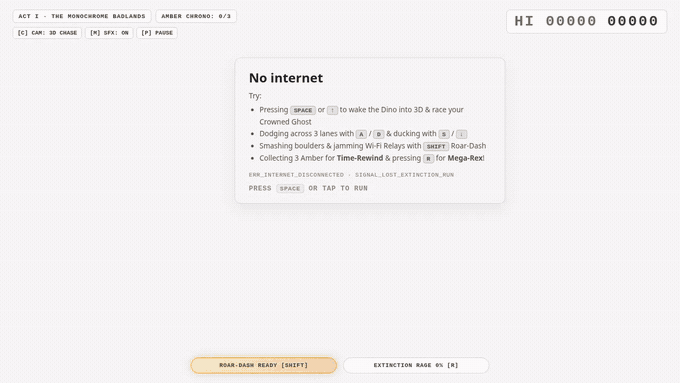
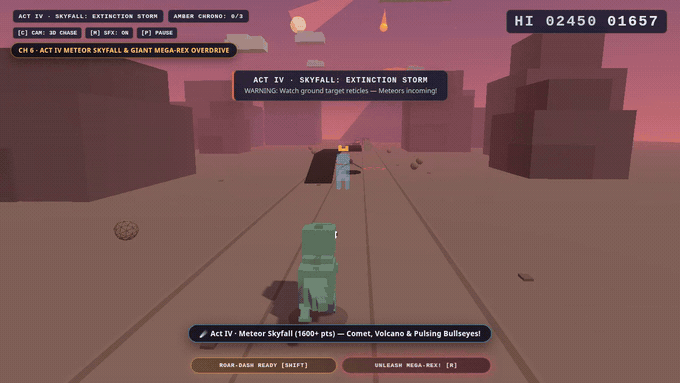

# Signal Lost: Extinction Run — 3D Chrome Dino Platformer-Runner

> **Play Live in Browser:** [**https://rabimba.github.io/dino-3d/**](https://rabimba.github.io/dino-3d/)  
> **Built with:** TypeScript · Three.js (WebGL2 + UnrealBloom) · Procedural WebAudio Synth · Vite · Vitest (`19/19` tests) · **Zero external assets (~152 KB gzipped)**



**Signal Lost: Extinction Run** reimagines Chrome's iconic offline `ERR_INTERNET_DISCONNECTED` T-Rex runner as a full **3D three-lane platformer-runner**—built end-to-end as a capability stress-test of **Gemini Carbon**. It starts on a pixel-faithful flat monochrome *"No Internet"* screen; the instant you press `SPACE`, the camera orbits `75°` into a living 3D prehistoric canyon that escalates across **five narrative acts** from quiet desert cacti to a full-sky **Chicxulub meteor storm**.



---

## 5-Act Story Progression & 700-Point Night Mode

| Era / Milestone | Score Threshold | World & Visual Evolution | New Challenges & Interactions |
| :--- | :--- | :--- | :--- |
| **Prologue — Signal Lost** | `Pre-Start` | Orthographic-style 2D monochrome Chrome *"No Internet"* screen | Press `SPACE` / Tap → `75°` camera orbit into 3D |
| **Act I — Monochrome Badlands** | `0 – 399` | Crisp monochrome-to-sandstone desert, rolling tumbleweeds | Single/clustered Saguaros, stone ramps, **Crowned Ghost Rival** |
| **Act II — Canyon Winds** | `400 – 899` | Warm golden-hour terracotta cliffs, desert blossoms | 3-altitude **Pterodactyls**, **Cracked Boulders** (`SHIFT` smash), Rock Arches |
| **Chrome Night Mode Cycle** | Every `700` pts | Inverted starry night sky, crescent moon, neon rim-lights | High-contrast silhouette tribute (`220` pts duration per cycle) |
| **Act III — Tectonic Awakening** | `900 – 1,599` | Deep twilight amber canyon, smoking distant volcano | **Chasms**, **Crumbling Bridges**, **Tar Patches**, **Steam Geysers** → Tier-2 Sky Mesas |
| **Act IV — Chicxulub Skyfall** | `1,600 – 2,499` | Volcanic crimson sky, blazing fractured comet overhead | **Falling Meteors** (`1.3s` ground bullseyes), **Molten Craters**, **Obsidian Launch Ramps** |
| **Act V — Extinction Overdrive** | `2,500+` | Prehistoric aurora + ember storm at peak velocity | Dense multi-tier gauntlets, rapid meteor volleys & boss waves |

---

## Three Signature Gameplay Twists

1. **Reconnecting Wi-Fi Satellite Meta-Boss (`620` pts & every `1,050` pts):** If the internet reconnects, Lonely Rex ceases to exist! A giant 3D Wi-Fi Router Satellite descends from orbit, sweeping a cyan scan-beam across lanes and dropping `ERR_404` monoliths and Signal Relay pylons. Smash **3 Signal Relays** with `[SHIFT]` Roar-Dash (`+150 CONNECTION REFUSED!`) to jam the router!
2. **Prehistoric Amber `2.0s` Time-Rewind & Crowned Ghost Rival:** Collect **3 glowing Amber Crystals** on risky upper plateaus to arm an orbiting golden Chrono-Shield. Instead of an instant Game Over, a lethal hit shatters the Amber and physically rewinds the entire 3D world **`2.0 seconds` backward** (`◀◀ AMBER CHRONO-REWIND`), while your best run races beside you live as a translucent cyan **Crowned Ghost**!
3. **`2.35×` Giant Mega-Rex Rage Overdrive (`[R]`):** Chain boulder smashes (`+28%`), near-miss grazes (`+18%`), and Amber pickups (`+14%`) to fill your **Extinction Rage Meter**. Press `R` (or auto-trigger on a fatal hit at `100%` Rage!) to grow **`2.35×` giant** with glowing magma seams—stomping obstacles flat (`+40 MEGA STOMP!`) and headbutting falling meteors back into space (`+120 METEOR HEADBUTT!`)!

---

## Controls

| Action | Keyboard | Touch / Mobile | Gamepad |
| :--- | :--- | :--- | :--- |
| **Jump / Variable Hop / Double-Jump** | `Space` / `W` / `↑` | Tap / Mid-air Tap | `A` |
| **Crouch-Slide / Mid-Air Ground-Pound** | `S` / `↓` | Swipe Down | `B` |
| **Switch Lanes (`Left` / `Center` / `Right`)** | `A` / `D` or `←` / `→` | Swipe Left / Right | `D-Pad` / `L-Stick` |
| **Roar-Dash (Smash Boulders/Relays & Cross Chasms)** | `Shift` / `E` | Double-Tap / Dash Pill | `X` / `RB` |
| **Mega-Rex Overdrive (`2.35×` Giant Kaiju Mode)** | `R` / `F` *(or auto-clutch)* | Rage Pill | — |
| **Cycle Camera (`3D Chase` · `Cinematic` · `Classic 2.5D`)** | `C` | `[C] CAM` Button | `Y` |
| **Mute Procedural Audio / Pause** | `M` / `P` (`Esc`) | HUD Buttons | `Start` |

---

## Instant Jump-In URL Shortcuts

Want to test a specific Era or Twist immediately? Append any query flag to the live URL or local dev server:

- [**`?wifiBoss=1`**](https://rabimba.github.io/dino-3d/?wifiBoss=1) — Immediately summon the **3D Wi-Fi Router Satellite Boss**
- [**`?chronoReady=1`**](https://rabimba.github.io/dino-3d/?chronoReady=1) — Start with an armed **Amber Chrono-Shield** (`2.0s` Time-Rewind ready)
- [**`?megaReady=1`**](https://rabimba.github.io/dino-3d/?megaReady=1) — Start at **100% Extinction Rage** ready to unleash **Mega-Rex (`[R]`)**
- [**`?startScore=415`**](https://rabimba.github.io/dino-3d/?startScore=415) — Jump straight into **Act II: Canyon Winds**
- [**`?startScore=690`**](https://rabimba.github.io/dino-3d/?startScore=690) — Watch Chrome's **700-Point Night Mode Inversion** trigger live
- [**`?startScore=920`**](https://rabimba.github.io/dino-3d/?startScore=920) — Jump into **Act III: Tectonic Awakening** (Steam Geysers & Sky Mesas)
- [**`?startScore=1650&megaReady=1`**](https://rabimba.github.io/dino-3d/?startScore=1650&megaReady=1) — Jump straight into **Act IV: Chicxulub Meteor Storm** with Mega-Rex armed!

---

## Local Development & Verification

```bash
npm install
npm run dev      # Launch local Vite dev server on http://localhost:5173
npm test         # Run 19 Vitest unit specs (physics, collisions, director, twists)
npm run build    # Type-check & build zero-asset production bundle into dist/
```
